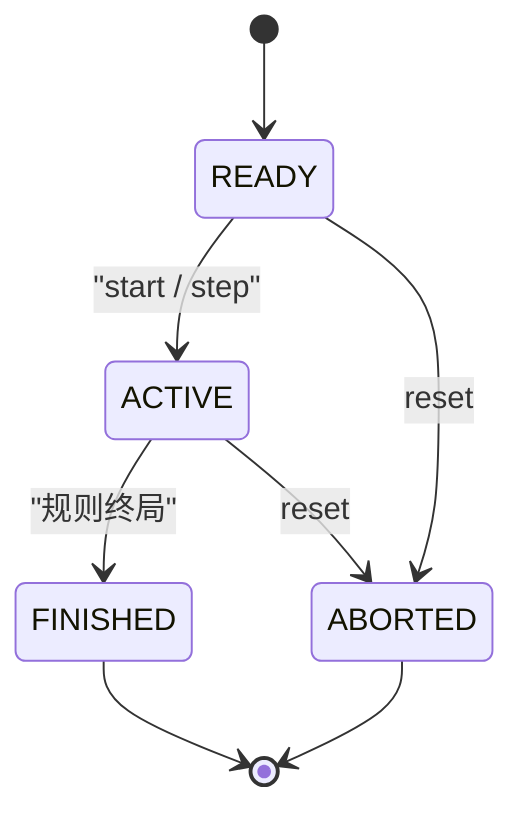
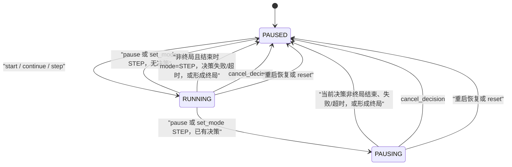
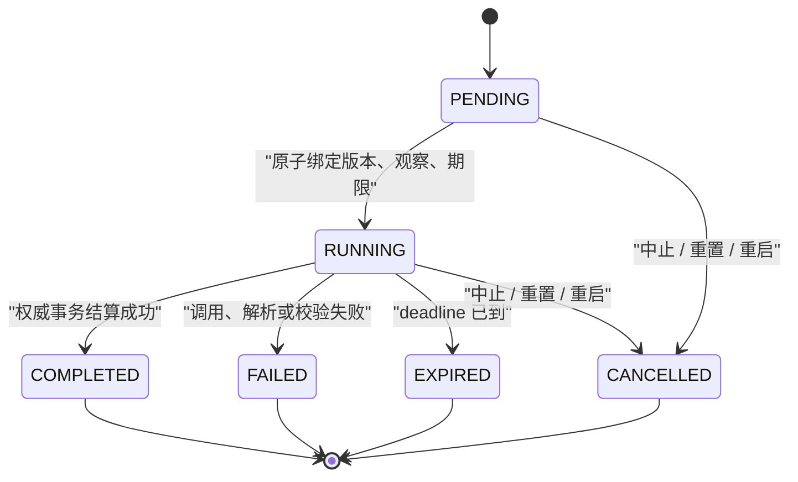
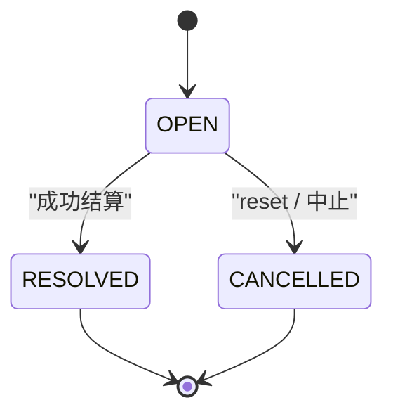
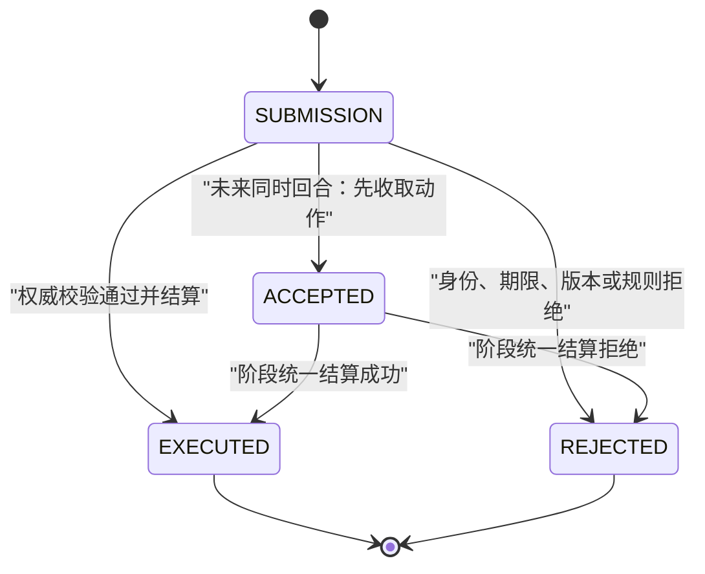

# 后端核心契约

图对应已有 Java 契约。状态迁移以 [领域模型](../docs/03-domain-model.md) 为准。箭头表示协作方向：`domain` 不依赖外层，`engine`、`application`、`agent` 依赖 `domain`，`adapter` 再依赖它们。

## 类关系

```mermaid
classDiagram
  direction TB
  class GameState
  class GameAction
  class GameObservation
  class GameDefinition
  class GameEventDraft
  class Resolution
  class GameKey
  class Participant
  class TurnPlan
  class GameResult
  class ParticipantStanding
  class GameRegistry
  class GameCodec

  GameDefinition --> GameKey
  GameDefinition --> Participant
  GameDefinition --> GameState
  GameDefinition --> GameAction
  GameDefinition --> GameObservation
  GameDefinition --> TurnPlan
  GameDefinition --> Resolution
  Resolution --> GameEventDraft
  Resolution --> GameResult
  GameResult --> ParticipantStanding
  GameRegistry --> GameDefinition : definition
  GameRegistry --> GameCodec : codec
  GameCodec --> GameState
  GameCodec --> GameAction
  GameCodec --> GameObservation

  class Room
  class RoomHealth
  class Match
  class TurnContext
  class TurnStatus
  class ControlCommand
  class CommandResult
  class TurnScheduler
  class StartedDecision
  class DecisionLifecycle
  class GameEngine

  Room --> Match : activeMatch
  Room --> RoomHealth
  Match --> GameKey
  Match --> Participant
  Match --> TurnContext
  TurnContext --> TurnStatus
  TurnScheduler --> ControlCommand : handleCommand
  TurnScheduler --> CommandResult
  DecisionLifecycle --> StartedDecision : start
  GameEngine --> GameDefinition : apply

  class Decision
  class Settlement
  class SettledAction
  class DecisionStatus
  class ActionEnvelope
  class ActionSubmissionResult
  class SubmissionStatus
  class AgentRunner
  class RuntimeOutcome
  class SelectedAction
  class StructuredAction
  class AgentRuntime
  class AgentContextBuilder
  class ModelAdapter
  class ActionSubmitter

  Decision --> TurnContext
  Decision --> DecisionStatus
  AgentRuntime --> RuntimeOutcome
  RuntimeOutcome <|-- SelectedAction
  RuntimeOutcome <|-- StructuredAction
  AgentRunner --> AgentRuntime : decide
  AgentRunner --> AgentContextBuilder : build
  AgentRunner --> ModelAdapter : invoke
  AgentRunner --> ActionSubmitter : submit
  ActionSubmitter --> ActionEnvelope
  ActionSubmitter --> ActionSubmissionResult
  ActionSubmissionResult --> SubmissionStatus
  Settlement --> SettledAction
  Settlement --> Match

  class PromptVersion
  class AgentConfiguration
  class PromptPublisher

  PromptPublisher --> PromptVersion : publish
  Decision --> PromptVersion : binds
  Decision --> AgentConfiguration : binds
```

- `GameState` / `GameAction` / `GameObservation`：规则状态、结构化动作和席位可见观察。
- `GameDefinition`：定义初始化、观察、动作校验、阶段结算和终局判定。
- `GameEventDraft` / `Resolution` / `GameResult` / `ParticipantStanding`：规则产生的事件草稿、结算结果、游戏结局和参与者名次。
- `GameKey` / `Participant` / `TurnPlan`：规则版本标识、局内席位和下一阶段计划。
- `GameRegistry` / `GameCodec`：按游戏键注册规则，并在 JSON 边界转换强类型对象。
- 四子棋规则位于 `domain.game.connectfour`，JSON 编解码和动作 Schema 位于 `adapter.game.connectfour`；尚未注册到运行时。快照解码严格核对棋盘、落子数量、席位、当前行动方、胜线和结果，拒绝无法满足不变量的数据，不推测完整历史。
- 四子棋动态校验依次返回 `UNKNOWN_PARTICIPANT`、`GAME_FINISHED`、`NOT_YOUR_TURN`、`INVALID_ACTION`、`COLUMN_OUT_OF_RANGE`、`COLUMN_FULL`；动作编解码另行严格检查静态字段与类型。
- `Room` / `Match`：跨重置的会话容器与其中的一局游戏。
- `TurnContext` / `TurnStatus`：行动阶段的身份、基准版本和生命周期。
- `ControlCommand` / `CommandResult`：控制请求及其确定性结果。
- `TurnScheduler` / `DecisionLifecycle`：房间串行调度入口与决策生命周期协调器。
- `GameEngine`：调用规则完成权威结算，不选择模型动作。
- `Decision` / `DecisionStatus` / `StartedDecision`：一次决策的生命周期、状态和启动时固定的版本、观察与期限快照。
- `RuntimeOutcome` / `SelectedAction` / `StructuredAction`：Runtime 返回的候选选择、结构化动作或失败结果。
- `AgentRunner` / `AgentRuntime`：编排一次决策与执行 Agent 决策机制；二者都不能直接修改世界。
- `AgentContextBuilder` / `ModelAdapter`：构造模型输入并隔离具体模型供应商。
- `ActionEnvelope` / `ActionSubmitter`：带身份版本的动作提交，以及权威校验和结算入口。信封只携带身份、版本和 `action` 载荷，不定义效果；过、认输等动作种类由载荷表达，效果由 `GameDefinition` 决定。
- `ActionSubmissionResult` / `SubmissionStatus` / `Settlement` / `SettledAction`：提交回执、执行阶段、一次阶段结算及其包含的成功动作。整个阶段只推进一次 `stateVersion`。
- `PromptVersion` / `AgentConfiguration` / `PromptPublisher`：不可变策略版本、Runtime 配置快照和发布入口。
- `RoomHealth`：房间可用性标记，不参与 Match 或 Decision 的业务状态迁移。

## 回合与排名

`Match.participants` 不限定人数。`SchedulingMode.TURN_BASED_SEQUENTIAL` 的 `requiredParticipants` 只有一个席位；`TURN_BASED_SIMULTANEOUS` 列出本阶段必须行动的全部席位，这些 `Decision` 共享同一个 `turnId`。`Match.currentTurnId` 仍只有一个，不表示多个并行阶段。

`GameResult.standings` 用名次覆盖 1v1、混战和完整排名。相同 `rank` 为并列，`rank` 1 为胜者；`score` 可选。`WIN` 至少有一个 `rank` 1，`DRAW` 不要求胜者。`ABORTED` 仍是运行终止，不是规则结局。

`Settlement` 携带本阶段的 `List<SettledAction>`：顺序回合一条，同时回合多条，整个阶段只把 `stateVersion` 增加 1。同时回合的动作收集器、截止策略和持久化尚未实现。`ACCEPTED` 只表示动作已收取，不表示世界已经改变。`CANCEL_DECISION` 取消当前回合全部未完成决策，不结束 Match。

## MatchStatus

`ABORTED` 是运行终止，不是某方获胜。终局后除 reset 外不再推进；reset 隔离旧局并建立新的 `READY` 局。

## ExecutionStatus

`ExecutionStatus` 是执行调度状态，包含当前房间暂停、运行或等待暂停；它与描述单局生命周期的 `MatchStatus` 正交。终局由 `MatchStatus.FINISHED` 表示，结算后 Room 保持 `PAUSED` 且不再推进。`ExecutionMode` 只有 `AUTO` 与 `STEP`：模式决定下一次许可，执行状态决定当前是否运行。

`set_mode AUTO` 只改变模式，不解除 `PAUSED` 或 `PAUSING`；若在单步决策仍为 `RUNNING` 时切换，则按结算时的 `AUTO` 模式继续调度。终局优先：当前决策形成胜利或平局后，Match 置为 `FINISHED`，Room 保持 `PAUSED`，不再启动下一次决策。重启恢复会取消未完成决策并暂停。`reset` 保留同一 `Room`，但会隔离旧局，将 `activeMatchId` 指向新建的 `READY` Match，推进 `revision / eventSeq`，并把执行状态初始化为 `STEP / PAUSED`。

## DecisionStatus

MVP 中 `PENDING` 到 `RUNNING` 可以在同一次启动事务内完成。终态不能回到 `RUNNING`；迟到响应只追加审计，不改变原结果。

## TurnStatus

一个 `Turn` 可以包含每名应行动参与者的 `Decision`，以及同一席位的失败重试。只有权威成功结算才推进 Match 的 `stateVersion`，且一次阶段结算只推进一个版本。`RESOLVED` 和 `CANCELLED` 都是终态。

过和认输都是 `action` 载荷中的游戏动作，不是 `TurnStatus`。游戏定义了该动作且校验通过后，与其他合法动作一样经权威结算：回执为 `EXECUTED`，回合变为 `RESOLVED`，整个阶段 `stateVersion` 加 1。过通常使对局保持 `ONGOING`，再由 `nextTurn` 给出下一阶段。认输由规则给出终局 `GameResult`，`Match` 变为 `FINISHED`；它不是 `ABORTED`，也不是 `CANCELLED`。`cancel_decision`、reset 和中止仍只把未结算阶段标为 `CANCELLED`，不推进 `stateVersion`。某游戏未定义该动作时按规则拒绝。四子棋当前只有 `place_disc`，不存在跳过动作；这是该游戏规则，不是平台禁止过。

## SubmissionStatus

MVP 运行的是顺序回合，提交最终只能是 `EXECUTED` 或 `REJECTED`。`ACCEPTED` 表示为同时回合预留的已收取动作，不能被当成世界已经改变。阶段结算契约已能携带多条动作，但动作收集器、截止策略和持久化尚未实现。

## RoomHealth

`RoomHealth` 是可用性标记，不是业务流程状态：

- `OK`：房间可以按当前执行状态接受控制或推进。
- `ERROR`：恢复、快照、规则版本或持久化存在故障；推进返回不可用错误并保留已有事实。

文档没有规定 `ERROR → OK` 的自动迁移，因此不在图中添加恢复迁移。
