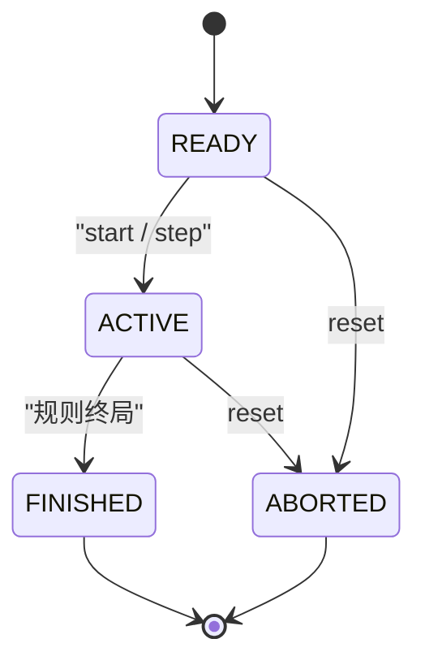
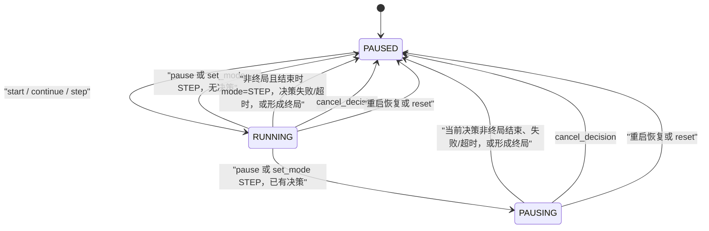
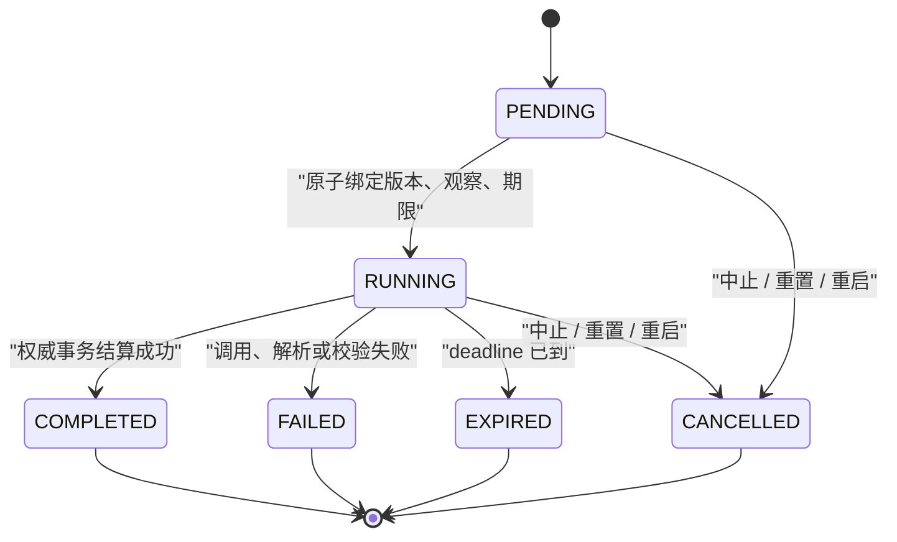
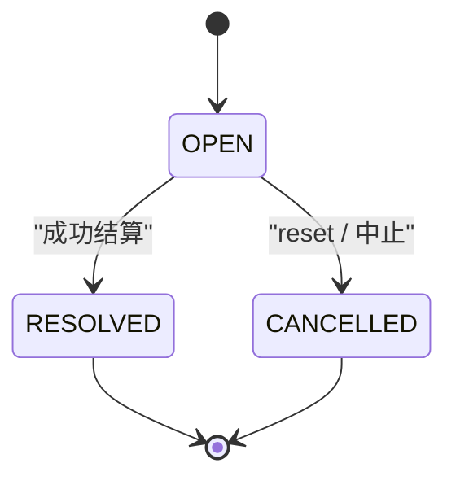
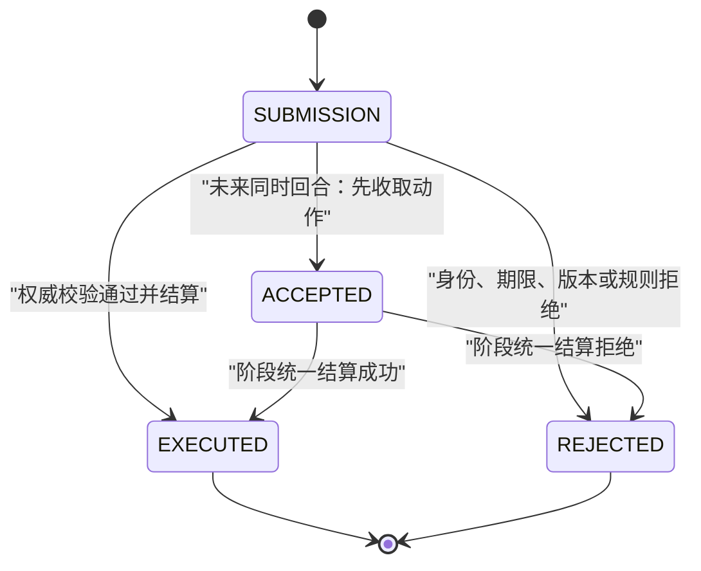

# 后端核心契约

图对应已有 Java 契约。状态迁移以 [领域模型](../docs/03-domain-model.md) 为准。箭头表示协作方向：`domain` 不依赖外层，`engine`、`application`、`agent` 依赖 `domain`，`adapter` 再依赖它们。

## 类关系

## 存储适配与事务

通用存储扩展端口位于 `application.port`，不要求具体游戏参与；`adapter.memory` 的各仓储共享同一个 `InMemoryStorage` 状态镜像，避免单仓储 map 无法随事务整体回滚。`InMemoryTransactionManager` 使用 Spring `AbstractPlatformTransactionManager` 和 `TransactionSynchronizationManager`，应用服务应从公开代理入口使用 `@Transactional(transactionManager="gameTransactionManager")`。写操作及 `RoomRepository.lock` 要求活动内存事务，普通读取可在事务外执行；提交整体替换已提交状态，回滚丢弃工作副本。

`frayground.storage.mode` 选择启动期适配：基础配置为 `database`，`dev` profile 为 `memory`。两种模式都保留默认 JDBC `transactionManager`，未指定 manager 的 `@Transactional` 使用它；`gameTransactionManager` 在 memory 模式管理内存状态，在 database 模式与 JDBC manager 为同一实例。memory 模式仍保留 DataSource/MyBatis 自动配置；database 模式仍需数据库仓储，当前尚未提供占位仓储或模式热切换。应用实例重建会得到空内存状态，内存模式不满足跨重启历史保留要求。内存事务在 beforeCommit 回调完成后封存工作副本；提交后的回调可读已提交结果，但不能再写入。

`laboratory` profile 使用 memory 和固定 Mock Agent。HTTP 写入经现有调度器，读取经单独的只读查询服务并投影为公开 DTO；房间初始化使用 `MatchFactory` 的完整初始化产物。决策历史读取由独立端口提供，后续数据库适配需要维持一致快照和游标语义。启动方式为 `./mvnw -pl frayground-app spring-boot:run -Dspring-boot.run.profiles=laboratory`；项目默认绑定 loopback。

```mermaid
classDiagram
  direction TB
  class GameState
  class GameAction
  class GameObservation
  class GameDefinition
  class GameEventDraft
  class Resolution
  class GameKey
  class Participant
  class TurnPlan
  class GameResult
  class ParticipantStanding
  class GameRegistry
  class GameRegistration
  class GameCodec
  class MatchFactory
  class InitializedMatch

  GameDefinition --> GameKey
  GameDefinition --> Participant
  GameDefinition --> GameState
  GameDefinition --> GameAction
  GameDefinition --> GameObservation
  GameDefinition --> TurnPlan
  GameDefinition --> Resolution
  Resolution --> GameEventDraft
  Resolution --> GameResult
  GameResult --> ParticipantStanding
  GameRegistry --> GameDefinition : definition
  GameRegistry --> GameCodec : codec
  GameRegistry --> GameRegistration : indexed by full key
  GameRegistration --> GameDefinition
  GameRegistration --> GameCodec
  GameRegistration --> ActionSchemaProvider
  MatchFactory --> InitializedMatch : create
  InitializedMatch --> Match
  InitializedMatch --> TurnContext
  InitializedMatch --> StateSnapshot
  GameCodec --> GameState
  GameCodec --> GameAction
  GameCodec --> GameObservation

  class Room
  class RoomHealth
  class Match
  class TurnContext
  class TurnStatus
  class ControlCommand
  class CommandResult
  class TurnScheduler
  class StartedDecision
  class DecisionLifecycle
  class GameEngine

  Room --> Match : activeMatch
  Room --> RoomHealth
  Match --> GameKey
  Match --> Participant
  Match --> TurnContext
  TurnContext --> TurnStatus
  TurnScheduler --> ControlCommand : handleCommand
  TurnScheduler --> CommandResult
  DecisionLifecycle --> StartedDecision : start
  GameEngine --> GameDefinition : apply

  class Decision
  class Settlement
  class SettledAction
  class DecisionStatus
  class ActionEnvelope
  class ActionSubmissionResult
  class SubmissionStatus
  class AgentRunner
  class RuntimeOutcome
  class RuntimeExecutionResult
  class DecisionModelAudit
  class SelectionOutputCodec
  class LlmAgentRuntime
  class RoutingAgentRuntime
  class SelectedAction
  class StructuredAction
  class AgentRuntime
  class AgentContextBuilder
  class DecisionInputReader
  class StatelessContextBuilder
  class MockAgentRuntime
  class ModelAdapter
  class ActionSubmitter

  Decision --> TurnContext
  Decision --> DecisionStatus
  AgentRuntime --> RuntimeExecutionResult
  RuntimeExecutionResult --> RuntimeOutcome
  RuntimeOutcome <|-- SelectedAction
  RuntimeOutcome <|-- StructuredAction
  AgentRunner --> AgentRuntime : decide
  LlmAgentRuntime --> AgentContextBuilder : build
  LlmAgentRuntime --> ModelAdapter : invoke once
  LlmAgentRuntime --> SelectionOutputCodec : schema and parse
  LlmAgentRuntime --> DecisionModelAudit : input audit
  RoutingAgentRuntime --> AgentRuntime : select bound type
  DecisionInputReader --> DecisionRequest : parse JSON shapes
  StatelessContextBuilder --> DecisionInputReader : parse fixed input
  StatelessContextBuilder --> BuiltContext : four bounded messages
  MockAgentRuntime --> DecisionInputReader : first supplied candidate
  AgentRunner --> ActionSubmitter : submit
  ActionSubmitter --> ActionEnvelope
  ActionSubmitter --> ActionSubmissionResult
  ActionSubmissionResult --> SubmissionStatus
  Settlement --> SettledAction
  Settlement --> Match

  class PromptVersion
  class AgentConfiguration
  class PromptPublisher

  PromptPublisher --> PromptVersion : publish
  Decision --> PromptVersion : binds
  Decision --> AgentConfiguration : binds
```

- `GameState` / `GameAction` / `GameObservation`：规则状态、结构化动作和席位可见观察。
- `GameDefinition`：定义初始化、观察、动作校验、阶段结算和终局判定。
- `GameEventDraft` / `Resolution` / `GameResult` / `ParticipantStanding`：规则产生的事件草稿、结算结果、游戏结局和参与者名次。
- `GameKey` / `Participant` / `TurnPlan`：规则版本标识、局内席位和下一阶段计划。
- `GameRegistry` / `GameRegistration` / `GameCodec`：Spring 配置显式注册规则、编解码器和动作 Schema；注册表按完整 `GameKey` 建不可变索引，不做版本回退。四子棋由 `frayground.games.connect-four.enabled=true` 开启，缺省或 `false` 时不注册；修改开关需重启。
- `MatchFactory` / `InitializedMatch`：应用层请求适配器创建初始 `Match`、首个 `TurnContext` 和版本 0 `StateSnapshot`。工厂只生成局内 ID 并使用规则初始化及编码；不保存数据、不创建 Agent/Prompt/Participant，也不启动调度或模型调用。保存边界由后续应用服务与持久化实现负责。
- 四子棋规则位于 `domain.game.connectfour`，JSON 编解码和动作 Schema 位于 `adapter.game.connectfour`。快照解码严格核对棋盘、落子数量、席位、当前行动方、胜线和结果，拒绝无法满足不变量的数据，不推测完整历史。
- 四子棋动态校验依次返回 `UNKNOWN_PARTICIPANT`、`GAME_FINISHED`、`NOT_YOUR_TURN`、`INVALID_ACTION`、`COLUMN_OUT_OF_RANGE`、`COLUMN_FULL`；动作编解码另行严格检查静态字段与类型。
- `Room` / `Match`：跨重置的会话容器与其中的一局游戏。
- `TurnContext` / `TurnStatus`：行动阶段的身份、基准版本和生命周期。
- `ControlCommand` / `CommandResult`：控制请求及其确定性结果。
- `TurnScheduler` / `DecisionLifecycle`：房间串行调度入口与决策生命周期协调器。
- `GameEngine`：调用规则完成权威结算，不选择模型动作。
- `Decision` / `DecisionStatus` / `StartedDecision`：一次决策的生命周期、状态和启动时固定的版本、观察与期限快照。
- `RuntimeOutcome` / `SelectedAction` / `StructuredAction`：Runtime 返回的候选选择、结构化动作或失败结果。
- `AgentRunner` / `AgentRuntime`：编排一次决策与执行 Agent 决策机制；二者都不能直接修改世界。
- `AgentContextBuilder` / `ModelAdapter`：构造模型输入并隔离具体模型供应商。
- `DecisionInputReader` / `StatelessContextBuilder`：严格解析请求 JSON 形状并构造有字节预算的无状态四消息上下文；`MockAgentRuntime` 直接选择首个候选，不经 Builder 或模型。
- `AgentRuntimeConfiguration`：装配 JSON Reader、ContextBuilder 与 Mock Runtime；`DecisionExecutionModule` 显式装配审计、LLM Runtime 与按固定配置路由的 Runtime。`LlmAgentRuntime` 仅支持 STATELESS + ACTION_SELECTION，一次调用 DeepSeek ModelAdapter；STRICT_TOOL 需显式允许 Beta，默认 JSON_MODE。未实现 STRUCTURED_ACTION 和自动重试。
- `ActionEnvelope` / `ActionSubmitter`：带身份版本的动作提交，以及权威校验和结算入口。信封只携带身份、版本和 `action` 载荷，不定义效果；过、认输等动作种类由载荷表达，效果由 `GameDefinition` 决定。
- `ActionSubmissionResult` / `SubmissionStatus` / `Settlement` / `SettledAction`：提交回执、执行阶段、一次阶段结算及其包含的成功动作。整个阶段只推进一次 `stateVersion`。
- `PromptVersion` / `AgentConfiguration` / `PromptPublisher`：不可变策略版本、Runtime 配置快照和发布入口。
- `RoomHealth`：房间可用性标记，不参与 Match 或 Decision 的业务状态迁移。

## 回合与排名

`Match.participants` 不限定人数。`SchedulingMode.TURN_BASED_SEQUENTIAL` 的 `requiredParticipants` 只有一个席位；`TURN_BASED_SIMULTANEOUS` 列出本阶段必须行动的全部席位，这些 `Decision` 共享同一个 `turnId`。`Match.currentTurnId` 仍只有一个，不表示多个并行阶段。

`GameResult.standings` 用名次覆盖 1v1、混战和完整排名。相同 `rank` 为并列，`rank` 1 为胜者；`score` 可选。`WIN` 至少有一个 `rank` 1，`DRAW` 不要求胜者。`ABORTED` 仍是运行终止，不是规则结局。

`Settlement` 携带本阶段的 `List<SettledAction>`：顺序回合一条，同时回合多条，整个阶段只把 `stateVersion` 增加 1。同时回合的动作收集器、截止策略和持久化尚未实现。`ACCEPTED` 只表示动作已收取，不表示世界已经改变。`CANCEL_DECISION` 取消当前回合全部未完成决策，不结束 Match。

## MatchStatus

`ABORTED` 是运行终止，不是某方获胜。终局后除 reset 外不再推进；reset 隔离旧局并建立新的 `READY` 局。

## ExecutionStatus

`ExecutionStatus` 是执行调度状态，包含当前房间暂停、运行或等待暂停；它与描述单局生命周期的 `MatchStatus` 正交。终局由 `MatchStatus.FINISHED` 表示，结算后 Room 保持 `PAUSED` 且不再推进。`ExecutionMode` 只有 `AUTO` 与 `STEP`：模式决定下一次许可，执行状态决定当前是否运行。

`set_mode AUTO` 只改变模式，不解除 `PAUSED` 或 `PAUSING`；若在单步决策仍为 `RUNNING` 时切换，则按结算时的 `AUTO` 模式继续调度。终局优先：当前决策形成胜利或平局后，Match 置为 `FINISHED`，Room 保持 `PAUSED`，不再启动下一次决策。重启恢复会取消未完成决策并暂停。`reset` 保留同一 `Room`，但会隔离旧局，将 `activeMatchId` 指向新建的 `READY` Match，推进 `revision / eventSeq`，并把执行状态初始化为 `STEP / PAUSED`。

## DecisionStatus

MVP 中 `PENDING` 到 `RUNNING` 可以在同一次启动事务内完成。终态不能回到 `RUNNING`；迟到响应只追加审计，不改变原结果。

## TurnStatus

一个 `Turn` 可以包含每名应行动参与者的 `Decision`，以及同一席位的失败重试。只有权威成功结算才推进 Match 的 `stateVersion`，且一次阶段结算只推进一个版本。`RESOLVED` 和 `CANCELLED` 都是终态。

过和认输都是 `action` 载荷中的游戏动作，不是 `TurnStatus`。游戏定义了该动作且校验通过后，与其他合法动作一样经权威结算：回执为 `EXECUTED`，回合变为 `RESOLVED`，整个阶段 `stateVersion` 加 1。过通常使对局保持 `ONGOING`，再由 `nextTurn` 给出下一阶段。认输由规则给出终局 `GameResult`，`Match` 变为 `FINISHED`；它不是 `ABORTED`，也不是 `CANCELLED`。`cancel_decision`、reset 和中止仍只把未结算阶段标为 `CANCELLED`，不推进 `stateVersion`。某游戏未定义该动作时按规则拒绝。四子棋当前只有 `place_disc`，不存在跳过动作；这是该游戏规则，不是平台禁止过。

## SubmissionStatus

MVP 运行的是顺序回合，提交最终只能是 `EXECUTED` 或 `REJECTED`。`ACCEPTED` 表示为同时回合预留的已收取动作，不能被当成世界已经改变。阶段结算契约已能携带多条动作，但动作收集器、截止策略和持久化尚未实现。

## RoomHealth

`RoomHealth` 是可用性标记，不是业务流程状态：

- `OK`：房间可以按当前执行状态接受控制或推进。
- `ERROR`：恢复、快照、规则版本或持久化存在故障；推进返回不可用错误并保留已有事实。

文档没有规定 `ERROR → OK` 的自动迁移，因此不在图中添加恢复迁移。

## 决策执行模块

`TurnSchedulingModule` 由调用方显式导入并复用 `DecisionExecutionModule`，调用方提供已初始化的房间、绑定、时钟、ID 和恢复服务。房间命令在事务内保存确定性回执；提交后由房间队列启动 tick，模型运行使用独立执行器。每个决策有独立截止任务；重置保留旧局并隔离迟到结果。控制执行器、决策执行器及截止执行器可以由调用方提供。该模块不创建演示房间，也不实现重启恢复。

启动事务失败时，调度器在核对房间和局仍未变化后暂停并记录原因。决策输出已暂存而写入失败时，房间暂停并保留原决策、输出和期限；人工继续可恢复同一输出和动作 ID，仍按原期限裁决，不重新调用 Runtime。

期限到达后若事务写入失败，调度器对同一决策安排单个延迟重试；每次重试重新核对当前房间、局和决策。重试不延长原期限，也不重新调用 Runtime。

决策终态提交后，调度器通过暂存存储的认领和释放协议清理临时输出；若其他恢复者持有认领，则延迟重试，正式审计和回执继续保留。

`DecisionExecutionModule` 由调用方显式导入，并提供绑定读取器、时钟、ID 来源、Runtime、游戏注册和元数据。启动事务锁定 Room 后固定观察、候选、规则说明、Prompt 与配置版本；输入快照与决策、审计占位及 Room 事件一起提交。内存快照属于同一事务镜像，进程退出后不保留。当前绑定读取器由调用方提供，尚无生产版本仓储。

Runner 在事务外调用 Runtime，只能从固定候选中选择，随后通过事务服务记录候选并交给 Submitter。Submitter 锁定 Room，先检查已有回执，再校验身份、版本、期限和游戏规则；合法动作的回执、结算、快照、事件、决策及 Room 变更在同一事务中提交。规则适配器负责具体状态、动作和观察的 JSON 转换以及下一阶段计划，应用层不解析棋盘。版本 0 沿用初始工厂的原始状态；本模块生成的后续快照使用带版本标记的 JSON 包装，以支持顶层 null，读取时由适配器还原。

Runtime 调用前由事务在 Room 锁内核对当前决策及期限并写入一次性执行认领；多个 Runner 实例共享该认领。生成的提交 Envelope 在提交前固定，可在存储故障后按原 ID 重提，不重新调用 Runtime。认领及 Envelope 在内存模式与其他数据一起回滚，未来持久化实现需提供相同原子性。Room 事件使用 API 定义的 `DECISION_STARTED`、`DECISION_FINISHED`、`ACTION_RESOLVED` 和 `MATCH_FINISHED`；一次操作只增加一次 revision，多个事件分别推进 eventSeq。

Runtime 返回后、审计和 Envelope 写入前，完整候选及其已生成的 actionId 暂存在本进程共享的恢复存储中。写入失败时，使用相同固定输入重新调用 Runner 可由同一应用上下文中的另一 Runner 认领并续写，且不会再次调用 Runtime；恢复者串行化，成功或终态后释放暂存。恢复时仍在 Room 锁内检查当前局、决策和期限。此暂存不属于持久化事务，不跨进程或应用上下文；进程崩溃或数据库故障期间尚未落库的模型输出可能丢失，不能据此承诺崩溃恢复或跨实例恢复。

执行认领后产生的失败、异常、未知候选和取消也先暂存在同一恢复存储中；收尾写入失败后只重试状态和审计写入，不再次调用 Runtime。恢复候选时若观察到取消，先把暂存结果变为取消，再执行收尾；锁内服务器期限和已有终态仍优先。执行认领之前的输入拒绝不创建暂存结果。

仅顺序阶段可启动和结算；同时阶段明确拒绝。取消关闭当前 Turn，恢复时建立相同编号和基准版本的新 Turn。失败或到期保留 OPEN Turn，不推进状态版本。此模块不包含自动调度、超时扫描、命令 API、数据库仓储或模型 Runtime；内存事务测试不能证明数据库的锁和唯一约束。
