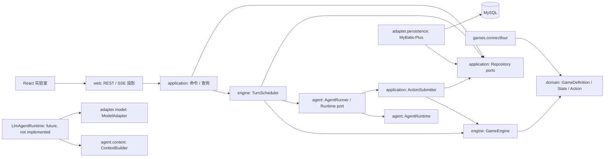
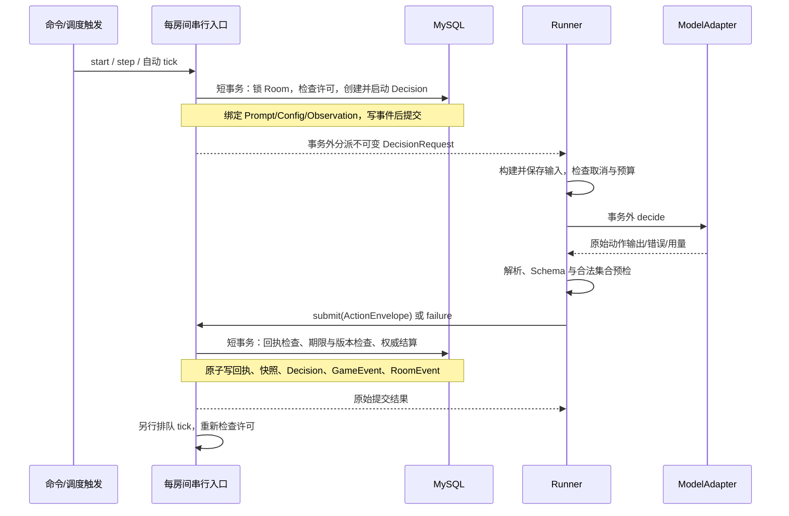
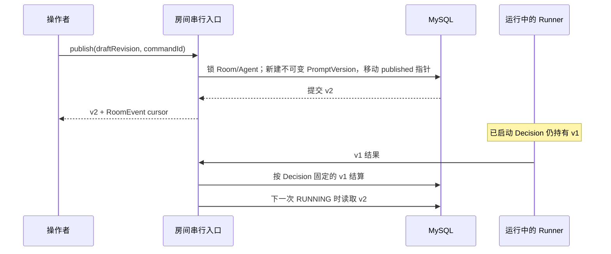

# 系统架构

> 已采纳设计，待实现。术语与生命周期以[领域模型](03-domain-model.md)为准，公共 JSON 以[OpenAPI](openapi.yaml)为准。

## 1. 技术基线与环境

| 项目 | 设计基线 | 管理方式 |
| --- | --- | --- |
| Java / Spring | Java 21 / Spring Boot 4.1.1 | 单 Maven 工程；Boot BOM 管理 Spring 依赖 |
| 构建 | Maven 3.10.0；后续纳入 Maven Wrapper | 不使用 Maven 4 预览版 |
| 持久化 | MySQL 8.4 LTS、InnoDB、utf8mb4；MyBatis-Plus 3.5.17 Boot 4 starter | JDBC 驱动沿用 Boot BOM；镜像后续锁定补丁及摘要 |
| JSON | Jackson 3.1.5（Boot BOM）、networknt Validator 3.0.8 | Schema 2020-12；禁止从模型获取远程 `$ref` |
| 测试 | JUnit Jupiter 6.0.3、Testcontainers 2.0.5（Boot BOM） | 用户确认从原文 JUnit 5 调整为 Boot 默认版本 |
| 前端 | React 19.3、TypeScript 6.0、Vite 8、Radix Themes 3 | npm lockfile 固定后续选择的补丁；不用浮动 latest 生成 |
| 通信 | Spring MVC REST + SseEmitter；OpenAPI 3.1.1 | 不引入 WebFlux、WebSocket 或消息中间件 |
| 模型 | Apache HttpClient 5 异步池 / DeepSeek Chat Completions | 每家服务商独立客户端、连接池和 I/O reactor；不引入 Spring AI 或 LangChain4j |

核验日期 2026-10-19；这些是文档与 BOM 的兼容基线，不代表本仓库已经通过依赖解析或运行测试。[Boot 要求](https://docs.spring.io/spring-boot/system-requirements.html)、[BOM](https://docs.spring.io/spring-boot/appendix/dependency-versions/coordinates.html)、[MyBatis-Plus](https://baomidou.com/getting-started/install/)、[Validator](https://github.com/networknt/json-schema-validator)、[Maven](https://maven.apache.org/docs/history.html)。前端依据：[React](https://react.dev/versions)、[TypeScript](https://devblogs.microsoft.com/typescript/announcing-typescript-6-0/)、[Vite](https://vite.dev/blog/announcing-vite8)、[Radix](https://www.radix-ui.com/themes/docs/overview/releases)。

本机只确认了 Temurin JDK 21、Node 24.19.0、Docker CLI；Maven 和 psql 未找到，mysql 客户端与 Docker daemon 未核验。psql 不再是所选方案的前置条件。本轮没有安装、连接数据库或执行模型调用。

## 2. 模块与依赖

后端根包 `io.frayground`，先按包分模块，不建大量 Maven 子工程。Entity、HTTP DTO 和纯领域 Record 分开；不为每个 Record 建一层接口。领域不导入 Spring、Jackson、MyBatis 或模型框架。GameState/GameAction/GameObservation 为开放接口，不能用封闭 sealed 层次阻止新增游戏；sealed 可用于校验结果等平台内部封闭类型。



| 包/模块 | 职责 | 禁止承担 |
| --- | --- | --- |
| domain / games | 不可变领域对象、规则、合法观察、阶段、结算 | HTTP、LLM 消息、数据库注解 |
| engine | 调度许可、决策生命周期、纯规则调用 | 自行选列、模型输出修复 |
| application | 事务用例、Prompt 发布、动作提交、查询投影、Repository port | 厂商请求拼装 |
| agent | Runner、Runtime port、ContextBuilder、解析预检 | 修改权威状态、假冒模型成功 |
| adapter.model | DeepSeek/Mock 调用、能力、用量、错误归一化 | 生成平台身份字段、裁判 |
| adapter.persistence | MyBatis-Plus Entity/Mapper/JSON TypeHandler、锁与 CAS | 泄漏持久化对象到前端 |
| web | DTO、参数校验、错误映射、实验室 SSE | 暴露审计记录给任意 Agent |

`agent.input` 解析 DecisionRequest JSON 形状；`agent.context` 构造有预算的 stateless 上下文；`agent.runtime` 包含 Runtime 实现。当前 Spring 装配仅提供 Reader、Builder 和确定性 Mock Runtime。业务实现不依赖 Spring；未来 LLM Runtime 复用 Builder 和 ModelAdapter，仍未实现。

engine 的当前契约：

```java
public interface TurnScheduler {
    void scheduleTick(UUID roomId, UUID expectedMatchId, String reason);
    CommandResult handleCommand(UUID roomId, ControlCommand command);
    void recoverBeforeReady();
}
public interface DecisionLifecycle {
    StartedDecision start(UUID roomId);
    void fail(UUID decisionId, String errorCode);
    void expire(UUID decisionId);
    void cancel(UUID roomId, UUID commandId);
}
public record StartedDecision(UUID roomId, UUID matchId, UUID decisionId,
    UUID participantId, UUID turnId, UUID promptVersionId, UUID configVersionId,
    long stateVersion, long observationVersion, String observationJson,
    String actionSpecificationJson, Instant deadline) {}
public interface GameEngine {
    <S extends GameState, A extends GameAction, O extends GameObservation>
        Resolution<S> apply(GameDefinition<S, A, O> definition,
            S state, Map<UUID, A> phaseActions);
}
```

`scheduleTick` 只在 `expectedMatchId` 仍是当前对局时排队。`start` 在 Room 锁内绑定 Prompt、配置、观察和期限，返回 `StartedDecision`；观察与动作说明是 JSON 字符串。`deadline` 是服务端到期时刻。`apply` 只对一个阶段已经给出的动作调用规则，顺序阶段一条、同时阶段多条，不选择动作也不落库。`fail`、`expire`、`cancel` 结束决策且不推进 `stateVersion`；`cancel` 覆盖当前回合全部未完成决策。`recoverBeforeReady` 在实例接单前取消未完成决策并保持暂停。

GameDefinition 在应用装配中注册 `(gameType, gameRulesVersion)` 与专属 Codec。JSON Schema、类型反序列化和快照 Codec 跟随注册项，纯规则层只接收强类型。缺少历史规则 Codec 时恢复该房间为故障暂停，不能用最新版静默解释旧数据。

## 3. 一次决策的分段数据流



每房间一个有界串行执行入口（MVP 可用锁保护的命令队列 + 共享工作线程），不同房间不共用全局锁。所有控制、发布、生效配置、超时、结果和自动 tick 都经过它。数据库 Room 行锁为持久化事务兜底；不把 JVM 队列作为唯一一致性措施。请求只等短命令结果，不等 LLM 完成。

模型调用前先持久化实际输入；调用开始与网络发出之间可能发生取消，底层取消尽力而为。平台保证取消后不落子，不保证供应商不计费，也不保证外部调用恰好一次。数据库暂不可用时停止分派和自动推进，不能以内存结果绕过持久化。

## 4. Prompt、控制与恢复

```java
public record PublishPrompt(UUID commandId, long expectedRoomRevision,
    UUID expectedMatchId, long expectedDraftRevision) {}
public interface PromptPublisher {
    PromptVersion publish(UUID roomId, UUID agentId, PublishPrompt command);
}
```

发布只接受 `expectedDraftRevision`，不另传正文。相同 `commandId` 返回原版本；相同草稿内容的新命令仍发布新版本。新版本从下一次尚未开始的决策生效。



同一事务内绑定配置和决策，定义“开始”的线性化点，不以浏览器点击时间或网络发送时间决定。暂停和 STEP 的详细转换见[领域状态机](03-domain-model.md)。自动 tick 必须另行排队并重新检查许可；不得在结算循环中无条件启动下一方。

启动恢复在对外就绪前完成：锁定每个非终局 Room/Match，取消 PENDING/RUNNING 决策并记录 `SERVER_RESTARTED`，置 PAUSED，保留快照、已结算回执及模式。COMPLETED 不重新执行。未知规则/损坏快照标记房间健康故障，控制返回 ROOM_UNAVAILABLE；不删除或猜测恢复。

## 5. SSE 与可见性

数据库 RoomEvent 是持久化推送日志，独立于仅游戏事实的 GameEvent。房间事务内递增 `event_seq`，插入投影事件；SSE 在事务外按游标读已提交事件，MVP 每 250ms 拉取一批，有事件后立即发送，15 秒发无 ID 心跳。无须额外 outbox 服务。

首次查询返回 RoomView + 同一事务读到的 `eventCursor`。随后订阅 `after=cursor`；重连优先 Last-Event-ID。持久化补发避免查询/订阅窗口漏事件；重复事件按序号丢弃。非法、超前游标返回错误；慢客户端有界缓存溢出即断开，由持久化游标重连。SSE 不推模型 Token 流，不推完整私有上下文。

实验室 API 是单操作者管理面；当前无正式账号系统，默认只监听 loopback，开发代理保持同源，不开放通配 CORS。未来外部 Agent 走独立授权入口和投影，不复用管理面的宽可见性。凭据只在服务端适配器边界读取，不写入 Prompt、JSON 记录、SSE 或前端产物。

## 6. 范围与选择理由

Spring AI 2.x 与 LangChain4j 均有 Boot 4 接入路径，不能以“不兼容”为拒绝理由。模型调用仍是一次 Chat Completions 和小动作 Schema，但不使用 JDK `HttpClient`：它不能按服务商限制物理连接数，默认完成线程也无界。每家服务商使用独立的 Apache HttpClient 5 异步客户端、连接池和 I/O reactor；最大连接数来自配置，池满时在同一次 `decisionTimeoutMs` 内等待，关闭 Bean 时释放客户端。不引入 OkHttp、Feign 或自动重试。未来仅替换 ModelAdapter 或 Runtime。[Spring AI](https://spring.io/blog/2026/06/12/spring-ai-2-0-0-GA-available-now/)、[LangChain4j](https://docs.langchain4j.dev/tutorials/spring-boot-integration/)。

顺序与同时回合共用阶段身份、Decision、观察和 Envelope；同时回合需新增动作收集器、截止策略和阶段结算事务。允许该扩展修改调度实现，不承诺零改动。持续世界、ECS、动态不可信插件均不进入当前设计。
