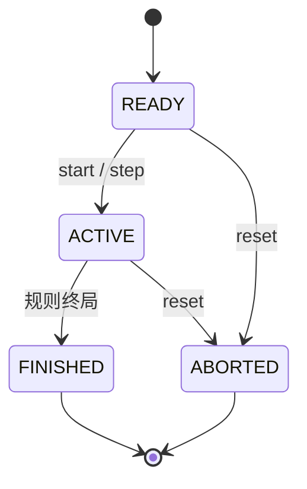
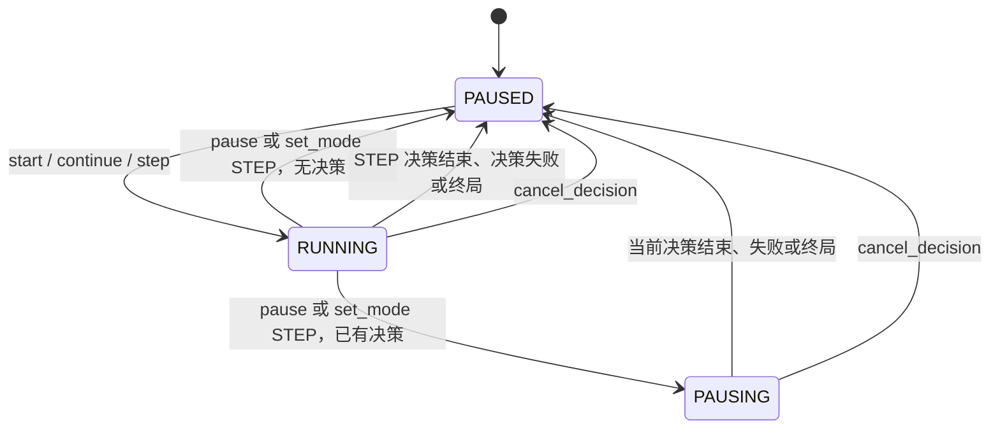
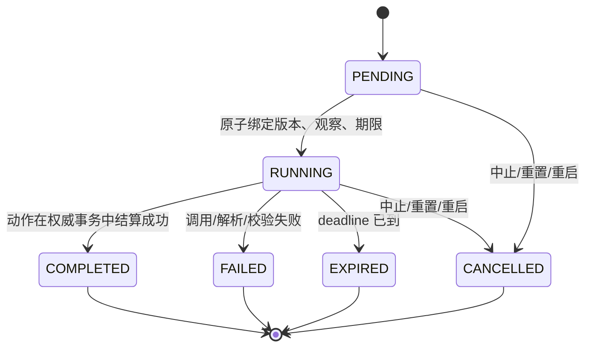

# 领域模型与状态机

> 已采纳设计，待实现。外部 DTO 不直接序列化以下 Java 对象。事务和唯一约束见[持久化设计](05-persistence.md)。

## 1. 身份、版本与记录

| 对象 | 身份与生命周期 | 责任 |
| --- | --- | --- |
| Agent | agentId，跨 Match | 可复用的决策实体，拥有草稿、发布指针和版本化配置 |
| GameRoom | roomId，跨重置 | 组织参与者配置、当前 Match、执行模式和控制修订号 |
| Match | matchId，一局 | 固定 gameType/rulesVersion，状态及结果；与 Room 不等同 |
| Participant | participantId，本局席位 | 关联 agentId、seatKey；重置后生成新 participantId |
| GameState | matchId + stateVersion | 权威规则状态；不可变，不供所有 Agent 直接读取 |
| GameObservation | decisionId + observationVersion | 针对席位的合法投影；MVP observationVersion = stateVersion |
| TurnContext | turnId，一次行动阶段 | turnNo、roundNo、应行动席位、基准状态版本、调度模式、TurnStatus |
| Decision | decisionId，一次尝试 | 固定输入与期限；同一 turnId 可含每名应行动者的尝试，失败重试创建新 ID |
| ActionEnvelope | actionId，一次提交 | 关联身份、基准版本和游戏 Payload；不是成功证明 |
| ActionSubmissionResult | actionId 的持久化回执 | EXECUTED / REJECTED；同时回合预留 ACCEPTED，不表示世界已改变 |
| ParticipantStanding | 一次结果中的参与者名次 | rank 从 1 起，相同 rank 为并列；score 可选 |
| Settlement | settlementId，一次阶段结算 | 关联本阶段全部成功动作及前后状态版本；整个阶段只推进一次 stateVersion |
| SettledAction | 阶段结算中的一条成功动作 | participantId、decisionId、actionId 与动作内容 |
| PromptDraft | agentId + revision | 可变草稿；只保存不生效 |
| PromptVersion | promptVersionId + versionNo | 不可变发布内容，与单个 Match 无绑定 |
| AgentConfig | configVersionId + versionNo | 不可变 Runtime/模型/MemoryPolicy 配置快照；Agent 指针指向最新版 |
| DecisionRecord | decisionId | 输入、上下文构造版本、模型动作输出、校验、执行回执、错误及用量 |
| GameEventDraft | 一次规则结算的产出 | type、eventVersion、payload；不含对局身份与序号 |
| GameEvent | matchId + sequence | 已记录的游戏客观事实，不等同于模型意图或完整审计 |
| RoomEvent | roomId + sequence | 管理面持久化推送事件，包括控制/配置/决策/世界变化 |

Round 表示游戏自己的大轮次；Turn/Phase 表示一次行动收集与结算阶段；Decision 表示某个席位的一次尝试；Action 是提交内容。MVP turnId 即阶段 ID，不再增加重复 phaseId 字段；四子棋 turnNo 从 1 开始，roundNo = floor((turnNo-1)/2)+1。失败不增加 turnNo/stateVersion；成功落子后创建下一 Turn。一次阶段结算无论包含一条还是多条动作，都只递增一次 stateVersion。

stateVersion 初始为 0，仅成功的权威规则结算递增；roomRevision 对控制、生效配置、Decision 转换及结算递增；草稿仅增加自己的 revision。RoomEvent sequence 为持续跨 Match 的推送游标，不与上述两者混用。

## 2. 最小 Java 接口草案

以下为文档签名，省略 imports、简单 ID Record 和校验构造器；实现时以独立编译的纯 Java 领域为目标。

```java
public interface GameState {}
public interface GameAction {}
public interface GameObservation {}

public record GameKey(String gameType, String gameRulesVersion) {}
public record Participant(UUID participantId, UUID agentId, String seatKey) {}
public record TurnContext(UUID turnId, long turnNo, long roundNo,
    long baseStateVersion, SchedulingMode schedulingMode,
    List<UUID> requiredParticipants, TurnStatus status) {}
public enum SchedulingMode { TURN_BASED_SEQUENTIAL, TURN_BASED_SIMULTANEOUS }
public enum TurnStatus { OPEN, RESOLVED, CANCELLED }
public record ParticipantStanding(UUID participantId, int rank, Double score) {}
public record GameResult(GameOutcome status, List<ParticipantStanding> standings,
    String reason) {}
public enum GameOutcome { ONGOING, WIN, DRAW }
public record SettledAction(UUID participantId, UUID decisionId, UUID actionId,
    Map<String, Object> action) {}
public record Settlement(UUID settlementId, UUID matchId, UUID turnId,
    long fromVersion, long toVersion, List<SettledAction> actions) {}

public interface GameDefinition<S extends GameState,
                                A extends GameAction,
                                O extends GameObservation> {
    GameKey key();
    S initialize(List<Participant> participants);
    TurnPlan nextTurn(S state, List<Participant> participants);
    O observe(S state, UUID participantId);
    ActionSpecification<A> actions(S state, UUID participantId);
    ValidationResult validate(S state, UUID participantId, A action);
    Resolution<S> resolve(S state, Map<UUID, A> phaseActions);
    GameResult result(S state);
    List<VisibleGameEvent> visibleHistory(
        UUID participantId, List<GameEvent> authoritativeEvents);
}
public record ActionOption<A>(String selectedActionId, A action) {}
public record ActionSpecification<A>(ActionGenerationMode mode,
    String actionSchemaId, List<ActionOption<A>> options,
    Map<String, Object> constraints) {}
public record TurnPlan(SchedulingMode mode, List<UUID> requiredParticipants) {}
public record GameEventDraft(String type, int eventVersion,
    Map<String, Object> payload) {}
public record Resolution<S>(S newState, List<GameEventDraft> events,
    GameResult result) {}

// JSON 和游戏专用类型在注册边界连接，不传入规则方法。
public interface GameCodec<S, A, O> {
    JsonNode encodeState(S state);
    S decodeState(JsonNode data);
    JsonNode encodeObservation(O observation);
    A decodeAction(JsonNode data);
    JsonNode encodeAction(A action);
}
public interface ActionSchemaProvider { JsonNode schema(String schemaId); }
public interface ActionParser<A> { A parse(JsonNode payload); }
public interface ActionValidator<S, A> {
    ValidationResult validate(S state, UUID participantId, A action);
}
public record ActionEnvelope(String protocolVersion, UUID matchId,
    UUID participantId, UUID turnId, UUID decisionId, UUID actionId,
    long stateVersion, Map<String, Object> action) {}
public interface ActionSubmitter {
    CompletionStage<ActionSubmissionResult> submit(ActionEnvelope envelope);
}
```

ActionParser 可由 Codec 实现，ActionValidator 可由 GameDefinition 实现，不要求各建一个实现类。ActionSchemaProvider 属协议适配模块；ActionSpecification 只通过稳定 schemaId 关联外部 Schema。Registry 是显式白名单，不开启 Jackson default typing 或按外部类名加载。领域记录中的 `action` 是 `Map`，不依赖 JSON 库。`ActionSubmissionResult.errorCode` 是提交错误码；HTTP `Error` 对象在 API 边界组装。`EXECUTED` 带已执行动作且没有错误码，`REJECTED` 相反，`ACCEPTED` 两者都为空。

GameResult 为 `ONGOING/WIN/DRAW`，用 standings 表示名次。ParticipantStanding.rank 从 1 起，相同名次为并列，rank 1 为胜者；score 可选。WIN 至少包含一个 rank 1。参与者数量不固定，因此同一结果可表达 1v1、多人混战和完整排名。DRAW 不要求胜者。Match 的 ABORTED 是运行终止，不伪造成某方获胜。

TURN_BASED_SEQUENTIAL 的 requiredParticipants 只有一名；TURN_BASED_SIMULTANEOUS 列出本阶段必须行动的全部席位，这些 Decision 共享同一 turnId。一个 Match 同时只有一个 currentTurnId。Settlement 记录本阶段的全部 SettledAction，顺序回合一条、同时回合多条，整个阶段只把 stateVersion 加一。同时回合的动作收集器、截止策略和持久化尚未实现。

过和认输都是 action 载荷中的游戏动作，不是 TurnStatus。ActionEnvelope 只携带身份、版本和载荷，不定义效果；效果由 GameDefinition 的 validate / resolve 决定。游戏定义了该动作且校验通过后，回执为 EXECUTED，回合变为 RESOLVED，整个阶段 stateVersion 加一。过通常使对局保持 ONGOING，再由 nextTurn 给出下一阶段。认输由规则给出终局 GameResult，Match 变为 FINISHED；它不是 ABORTED，也不是 CANCELLED。cancel_decision、reset 和中止仍只把未结算阶段标为 CANCELLED，不推进 stateVersion。某游戏未定义该动作时按规则拒绝。

规则结算产出 `GameEventDraft`。写入时补上 `matchId`、`sequence`、`stateVersion`、可空的 `decisionId` 和发生时间，成为 `GameEvent`。`visibleHistory` 读取的是已记录事件，并按席位省略不可见事实。若未来有随机性，应在规则输入中显式传入已记录的随机事件、种子与算法版本，不在纯规则内部读取时钟或随机源。

## 3. Match 与执行状态

MatchStatus：READY、ACTIVE、FINISHED、ABORTED。ExecutionMode：AUTO、STEP。ExecutionStatus：PAUSED、RUNNING、PAUSING。ExecutionStatus 只描述 Room 的执行调度，不表达 Match 是否终局；终局由 MatchStatus 表示，终局后的 Room 保持 PAUSED 且不再推进。房间另有 health=OK/ERROR 表示恢复或存储故障，不扩充为游戏胜负。





| 命令 | 前置条件 | 确定效果 |
| --- | --- | --- |
| start | READY/PAUSED | Match ACTIVE；mode AUTO；RUNNING，排队一个 tick |
| continue | ACTIVE/PAUSED | mode AUTO；RUNNING，排队一个 tick |
| step | READY 或 ACTIVE，且 PAUSED | 必要时激活 Match；mode STEP；RUNNING；创建一次许可 |
| pause | ACTIVE | RUNNING 且有活动决策则 PAUSING，否则 PAUSED；不取消；已暂停为幂等无变化 |
| set_mode STEP | 非终局 | 改 STEP；有决策则 PAUSING，无决策则 PAUSED；不创建许可 |
| set_mode AUTO | 非终局 | 只改 mode；已 PAUSED/PAUSING 不解除暂停；RUNNING 的单步决策可在结算后自动继续 |
| cancel_decision | 当前回合有 PENDING/RUNNING | 当前回合全部未完成 Decision CANCELLED；PAUSED；尽力取消网络；Match 不结束 |
| reset | 任意当前 Match | 未结束旧局 ABORTED，活动决策 CANCELLED；新局 READY/STEP/PAUSED，stateVersion=0 |

busy 时 step 返回 CONTROL_BUSY，并持久化命令回执，不排队；有暂停请求时 continue 同样返回 CONTROL_BUSY，待 PAUSED 后再操作。终局 pause/set_mode/start/continue/step/cancel 返回 MATCH_NOT_ACTIVE；reset 仍允许。

所有控制含 commandId、expectedRoomRevision、expectedMatchId。先查同 ID 回执，再检查版本和状态；相同命令重试返回原结果。不同 commandId 的重复点击也不能积累许可：串行化后第一次把 PAUSED 改为 RUNNING，后续 busy 或修订冲突。服务端确认切换后禁止启动新决策；若新决策在切换命令之前已线性化，则它们属于需要完成的当前回合，界面显示其 ID。

正常终局优先于“暂停后状态”：结算将 Match 置为 FINISHED、Room 执行状态置为 PAUSED，且不得再启动决策；不能把 FINISHED 覆盖成 ACTIVE。reset 使旧 Match 的所有许可失效并创建新 Match；排队 tick 必须检查所携带 matchId 和当前指针。

## 4. Decision 状态机



MVP PENDING 与 RUNNING 可以在同一启动事务中完成，外界通常只看到 RUNNING；不得在 PENDING 提前固定旧 Prompt，然后延迟到发布之后才声称启动。RUNNING 开始时间即事务内绑定点，deadline = startedAt + 30s。同一事务内保存确定性的 Observation 和候选映射；模型输入稍后由固定快照构造，并在发请求前持久化。

以取得 Room 锁后服务端 UTC 时间检查期限；到期条件为 now >= deadline。超时处理与提交竞争时，只能有一个终态获胜。SQL 查询超时回调可能延迟，所以提交路径自己也检查 deadline。终态不可再变为 RUNNING；迟到响应只追加审计说明，不改变原终态/结果。

非法动作导致 FAILED、棋盘不变、暂停；相同 Action ID 的不同请求内容属于冲突，不把已成功 Decision 改成 FAILED。未知/不匹配身份的请求不应使其他合法 Decision 失败。成功事件仅在 EXECUTED 后产生。

领域结算已经按阶段记录一条或多条动作，但动作收集器、截止策略和持久化尚未实现。未来同时回合可先令提交回执为 ACCEPTED，Decision 仍 RUNNING 并标记 submittedActionId；由统一阶段结算置 COMPLETED，不需要把“收到动作”当成状态结算。截止后的缺席策略与原子批结算属于未来实施决定，不在 MVP 偷加默认动作。

## 5. Connect Four 规则

```java
public record ConnectFourState(List<List<String>> board,
    List<UUID> participantOrder, UUID currentParticipantId,
    int moveCount, List<Cell> winningCells, GameResult result)
    implements GameState {}
public record PlaceDisc(String type, int column) implements GameAction {}
public record ConnectFourObservation(List<List<String>> board,
    String yourSeat, String currentSeat, List<Integer> legalColumns,
    int moveCount) implements GameObservation {}
```

- board 是 6 行 × 7 列，row=0 为顶部，column=0 为最左；值为 EMPTY/A/B，不是 agentId。Seat 到 Participant 的映射由 Match 提供。
- 初始化恰好两个不同席位 A/B，A 先手。participants 集合的通用设计不替代具体游戏人数检查。
- 非终局且为当前席位才可 place_disc；column 必须为整数 0..6，列顶非 EMPTY 则满列非法；不存在跳过动作。这是四子棋规则，不是平台禁止过或认输；本游戏 Schema 未定义二者，提交会被拒绝。
- 自 row=5 向上寻找首个空位，写入当前席位。围绕该格扫描横、竖、两条斜线；任一连续长度 >=4 则 WIN。先检查胜利，再在 moveCount=42 时判 DRAW，否则切换席位。
- 终局 currentParticipantId 为 null，合法动作列表为空；禁止进一步 resolve。
- 成功返回 DiscPlaced（row/column/seat/participantId）及可选 MatchFinished（result/winningCells）。新状态和集合均防御性复制；非法动作不得原地修改旧状态。
- action schemaId 为 `connect-four/place-disc/1`，规则版本为 `1`。列号静态范围属于 Schema，满列和行动顺序属于动态规则。
- ACTION_SELECTION 的局部 ID 为 `c0`..`c6`，只提供未满列，例如 `c3 -> {type:place_disc,column:3}`。局部 ID 的作用域是当前 Decision，不能当全局 actionId。

公开棋盘渲染数据含 board、seat 映射、lastMove、winningCells、result、stateVersion。Decision 的观察快照额外标明自身席位和合法列；不直接把整个 Match Entity 发给 Agent。

## 6. 第二游戏与扩展走查

测试夹具 TakeAway：初始 5 个石子，两个席位轮流取 1 或 2，取尽者获胜。State 为 remaining/currentSeat，Action 为 take(amount)，不含棋盘或 column。复用 Registry、GameEngine、Mock Runtime、ActionSubmitter；仅增加规则与 Codec/Schema。游戏结果与调度不需要改写。

四人资源竞争的 Stage 包含四个 requiredParticipants，观察由同一基准状态生成；各自 Decision 可有相同 stateVersion，不同 participantId。收齐后规则 resolve 一批动作、只推进一次世界版本。需新增收集与截止策略、阶段结算表及测试，允许改动调度实现；AgentRuntime、PromptVersion、Envelope 和上下文投影原则可复用。
