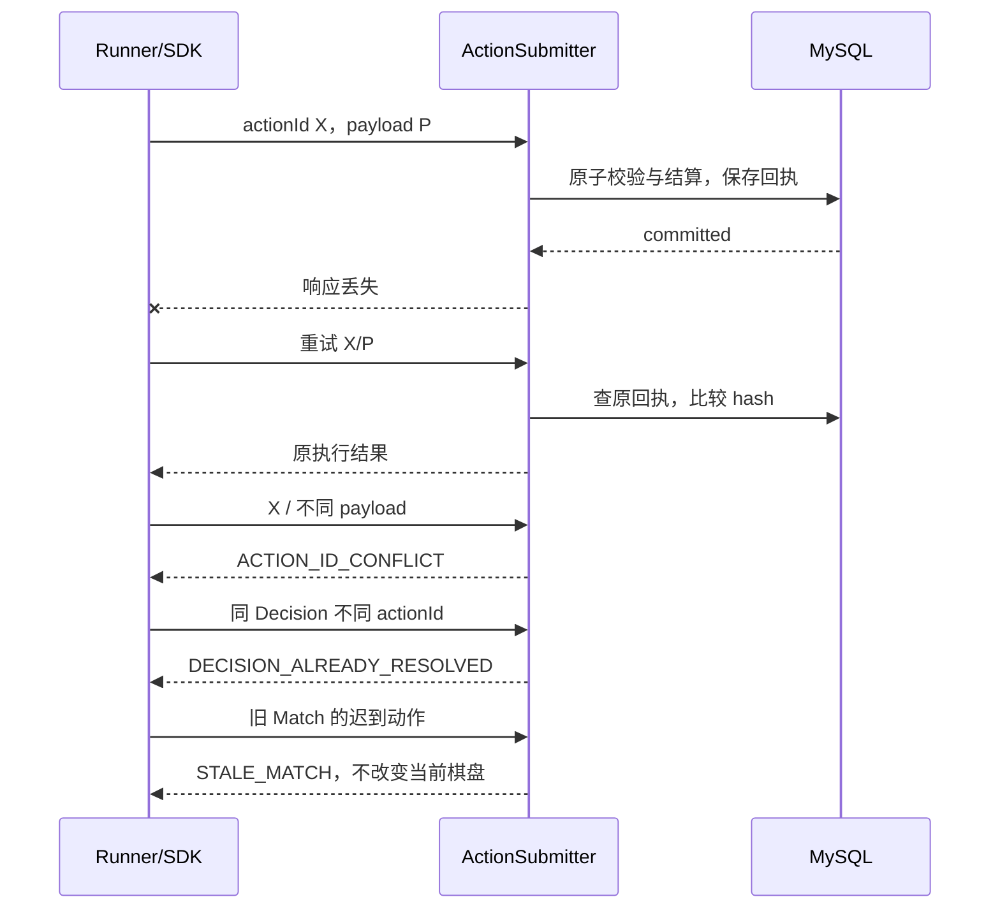

# Agent 协议、模型输出与记忆边界

> 已采纳设计，待实现。Envelope 的完整 Schema 与示例在 [OpenAPI](openapi.yaml)；状态机以[领域模型](03-domain-model.md)为准，存储约束以[持久化设计](05-persistence.md)为准。本文件解释职责，不维护第二套字段定义。

## 1. Envelope 与 Payload

平台定义 Envelope，游戏定义 action。Runner/未来 SDK 生成 actionId、关联平台提供的 Match/Turn/Decision 和 stateVersion；LLM 不负责身份或提交协议。通用引擎根据 Match 的 GameKey 找到 Codec 和 Schema，再将 JsonNode 转换为游戏强类型。JSON Schema 校验通过不等于动作在当前状态合法。

四子棋 Payload 为 `{"type":"place_disc","column":3}`。机器人可采用 `move_and_attack` + movement/attack，资源游戏可采用 trade + target/offer/request；这些未来示例的完整 Schema 位于 OpenAPI components，不进入 MVP 游戏注册表。游戏若在自身 Schema 中定义 `pass` 或 `resign`，它们是 action Payload，走同一提交与权威结算，不是控制命令。

protocolVersion 描述平台参与契约；gameRulesVersion 描述规则和状态解释；actionSchemaId 指定该规则注册的动作结构。Match 固定后两者，DecisionRequest 引用；Envelope 不重复附带可相互矛盾的规则版本。所有输入均不能以 JSON 字段指定任意 Java 类或远程 Schema URL。

## 2. Runner 与 Runtime 的最小契约

```java
public interface AgentRuntime {
    CompletionStage<RuntimeOutcome> decide(
        RuntimeInput input, CancellationSignal cancellation);
}
public record RuntimeInput(DecisionRequest publicRequest,
    Optional<HostedBindings> hostedBindings) {}
public record HostedBindings(PromptVersion prompt,
    AgentConfiguration configuration) {}
public interface AgentContextBuilder {
    BuiltContext build(DecisionRequest request,
        PromptVersion prompt, AgentConfiguration configuration);
}
public interface ModelAdapter {
    ModelCapabilities capabilities(ModelConfiguration configuration);
    CompletionStage<ModelInvocationResult> invoke(
        ModelRequest request, CancellationSignal cancellation);
}
public record ModelCapabilities(boolean nativeJsonSchema,
    boolean strictTools, boolean jsonMode, boolean plainJson,
    boolean betaRequired, Set<String> supportedSchemaKeywords) {}
public record ModelConfiguration(String provider, String modelId,
    boolean thinking, double temperature, int maxOutputTokens,
    int decisionTimeoutMs, String credentialRef, String outputStrategy,
    boolean allowBeta) {}
public record ModelRequest(List<ModelMessage> messages,
    String outputSchemaJson, ModelConfiguration configuration) {}
public record ModelInvocationResult(String providerRequestId,
    String actualModel, String content, List<ToolArguments> toolArguments,
    String finishReason, TokenUsage usage, Duration latency,
    RuntimeError error) {}
public record BuiltContext(String builderVersion,
    List<ModelMessage> messages, int utf8Bytes) {}
public sealed interface RuntimeOutcome
    permits RuntimeOutcome.SelectedAction, RuntimeOutcome.StructuredAction,
        RuntimeOutcome.Failed {
  record SelectedAction(String selectedActionId) implements RuntimeOutcome {}
  record StructuredAction(String actionJson) implements RuntimeOutcome {}
  record Failed(RuntimeError error) implements RuntimeOutcome {}
}
public interface AgentRunner {
    CompletionStage<DecisionOutcome> run(
        RuntimeInput input, CancellationSignal cancellation);
}
public sealed interface DecisionOutcome
    permits DecisionOutcome.Submitted, DecisionOutcome.NotSubmitted {
  record Submitted(RuntimeOutcome candidate, ActionSubmissionResult submission)
      implements DecisionOutcome {}
  record NotSubmitted(RuntimeError error) implements DecisionOutcome {}
}
```

ModelMessage 是平台自己的简单角色/文本对象，由 ModelAdapter 转成厂商 JSON；不是 Spring AI/DeepSeek 内部类。ModelResponse 可作为 ModelInvocationResult 的输出部分，不为重复包装新增无行为类。RuntimeInput 是内部 Java 契约，不直接序列化：HostedBindings 由 Runner 按 Decision 固定的版本 ID 加载，不能重新读取 Agent 最新指针；外部请求只序列化 publicRequest，第三方不获得 HostedBindings。

MVP RuntimeOutcome 为 SelectedAction、StructuredAction 或 Failed，不直接修改 Match。DecisionOutcome.Submitted 带上候选和权威回执；NotSubmitted 表示没有提交动作。未来远程异步提交可增加 SubmittedAction(actionId, receipt) 分支：远程 SDK 已经提交时，Runner 只观察原回执，不生成另一个 actionId 再提交；与本地 SelectedAction / StructuredAction 分支明确区分。

AgentRunner 是一次决策的编排器，不是另一套大型 Agent 框架：接收固定请求与绑定材料 → 选择 Runtime → 获得候选 → 解析、校验 → 构造 Envelope → ActionSubmitter → 返回并记录回执。LlmAgentRuntime 在其中使用 ContextBuilder 和 ModelAdapter；MockAgentRuntime 直接返回测试候选。事务性的动作提交独立于运行机制。

未来 RemoteHttpAgentRuntime 复用固定 DecisionRequest 与提交结果，第三方内部可用 Python、工具、工作流或自有模型；平台只等待协议结果。其内部策略、推理、Key 不要求上传，本地模型配置与 PromptVersion 可为空或由非敏感 agentVersion 代替。

## 3. 两种生成模式

| 模式 | 模型输出 | Runner 处理 | MVP |
| --- | --- | --- | --- |
| ACTION_SELECTION | `{selectedActionId:"c3"}` | 仅在本 Decision 的不可变候选表中查找，再得到强类型 Payload | 实现，四子棋默认 |
| STRUCTURED_ACTION | 游戏专属 action 对象 | 完整 Schema 校验、解析和动态预检 | 定义接口与夹具测试；不增加产品游戏 |

四子棋候选只含未满列，局部 c3 不等于全局 actionId。selection 输出 Schema 的 enum 按候选动态构建；动作提交仍验证真实 Payload，不能把“选中了合法候选”视作无需权威检查。外部 Agent 可直接生成 Payload 后封装，不必采用平台的模型提示或 selection 方式。

## 4. DeepSeek 能力与降级

截至 2026-10-19 官方文档：默认 API ID 为 `deepseek-flash`，当前指向 DeepSeek-V4.1-Flash-1017；支持 Chat Completions、Responses、JSON Output 和 Tool Calls。模型别名可能更新，记录请求 modelId 与响应实际标识，无法获得具体修订时如实标为别名而非可固定版本。[模型与价格](https://api-docs.deepseek.com/quick_start/pricing/)

| 能力 | 官方证据与限制 | 当前选择 |
| --- | --- | --- |
| Chat Completions | `/chat/completions`；response_format 文档枚举为 text/json_object | MVP 使用 |
| Responses | 已有独立接口，非必须 | 未来另加传输实现，无须改规则 |
| JSON Mode | json_object；需在指令中明确 JSON；可能空内容或因 length 截断 | 默认 + 本地校验 |
| 原生 json_schema response format | 所选 Chat Completions 文档未列出 | capabilities=false，不猜测可用 |
| strict Tool Calling | Beta 地址 `https://api.deepseek.com/beta`；严格对象需所有属性 required 且 additionalProperties=false | capabilities 标记 Beta，仅显式启用 |
| 普通文本 JSON | 无结构保证 | 仅兼容能力显式选择；不在失败时偷偷再调一次 |

依据：[Chat Completions](https://api-docs.deepseek.com/api/create-chat-completion/)、[JSON Output](https://api-docs.deepseek.com/guides/json_mode/)、[Tool Calls](https://api-docs.deepseek.com/guides/tool_calls/)、[Responses](https://api-docs.deepseek.com/guides/responses_api/)。strict 的 Schema 子集不能直接等同于完整 2020-12；适配器只下发其支持的关键字，本地仍检查完整 Schema。Tool Calling 在此仅用作动作参数输出通道，不运行任意工具，不追加第二次总结调用。

通用优先顺序是原生 Schema → 已允许的 strict tools → JSON Mode → 显式兼容的文本 JSON；根据 capabilities 和配置在发请求前选定。DeepSeek 默认跳过未确认或 Beta 能力，不进行“400 后自动换格式重试”。任何模式都只解析一次完整 JSON 对象；空、非法、缺字段、错误枚举、多个工具调用、拒绝、finish_reason=length 均失败暂停。

默认请求：model=deepseek-flash、thinking.type=disabled、temperature=0、max_tokens=256、stream=false、response_format.type=json_object；连接超时 5 秒，剩余总决策期限限制请求超时。temperature=0 不保证重复输出一致。返回 usage 缺失为 null，不填 0；不保留 reasoning_content。

官方价格核验快照（USD/百万 Token）：Flash 输入缓存命中低峰 0.003/高峰 0.006，未命中 0.15/0.30，输出 0.60/1.20；实际时段、地区与计费以调用时官方说明为准。MVP 记录用量，不建设金额硬预算。若展示估算必须标注价格快照时间和缓存/时段假设，不能将估算当账单。[价格依据](https://api-docs.deepseek.com/quick_start/pricing/)

## 5. 分层校验、提交与错误

1. ModelAdapter 施加实际支持的生成约束，并归一化 API 状态、finish reason、拒绝和用量。
2. Parser 拒绝空、多对象、非法 JSON、代码块包装；本地 Schema 校验字段、类型、枚举、范围和额外字段。
3. Runner 根据固定 Observation/候选检查选择或约束，生成 actionId 并保存同一 Envelope；不读取其他 Agent 的历史。
4. ActionSubmitter 在 Room 事务中再次校验资格、期限、Match/Turn/Decision、状态版本和规则，决定是否执行。

本地预检失败直接记录 Decision FAILED；不会伪造服务端成功事件。若模型内容合法但当前状态已取消/重置，提交必须被拒绝。网络/响应丢失后的动作提交最多自动重试一次且不超过原 deadline，必须复用 ID、Payload；数据库回执已经存在时即使期限已过也返回原结果。LLM 生成失败不自动重试。



Decision ID 是关联身份，不是凭证；可选未来 Turn Token 也不能替代身份授权。幂等保证防止重复执行，CSRF 处理浏览器跨站请求，stateVersion 防止过期结果，限流限制资源，Schema/规则决定动作结构及合法性，不能互相替代。

## 6. Stateless 输入与历史

每次 ContextBuilder 独立构建：平台固定 JSON 输出指令 + 游戏规则说明 + 绑定的玩家 Prompt + 当前合法 Observation + Action Schema/候选 + 必要非敏感上下文。模型不需要 matchId/actionId 等提交身份，不把无关字段发送给模型。明确将玩家文本与平台指令分段；玩家文本无权改变服务端验证。

保存固定 request、PromptVersion、ConfigVersion、builderVersion、实际 messages、Schema/候选以及允许的输出字段，能够重建“输入如何构造”；重新调用模型是新实验，不能保证同输出。不拼接以前的 assistant 消息、对手 Prompt、内部推理、默认回合历史或策略摘要。

Authoritative Game History 是平台完整客观事实；Visible Game History 是 GameDefinition 针对 viewer 的投影；DecisionRecord 是私有运行审计。四子棋公开落子基本一致，但 Prompt/模型输入不是公开历史。历史接口必须传 viewer，不能把完整内部事件数组直接发给未来 Agent。

## 7. 未来 MemoryPolicy

```java
public enum MemoryMode { STATELESS, RECENT_HISTORY, STRATEGY_MEMORY }
public record MemoryPolicy(MemoryMode mode, Integer recentEventLimit,
    Integer contextTokenBudget, String memoryResetPolicy) {}
public interface VisibleHistoryReader {
    List<VisibleGameEvent> read(UUID matchId, UUID participantId, int limit);
}
public interface StrategyMemoryReader {
    Optional<StrategyMemory> read(UUID matchId, UUID participantId);
}
```

MVP 只接受 `{mode:STATELESS}`，其他模式及附加参数返回 MEMORY_MODE_NOT_SUPPORTED，不展示未实现控件。预留配置草案：RECENT_HISTORY 使用最近 N 条该席位可见的客观事件，限定 Token 预算；STRATEGY_MEMORY 另读取本局自己维护的摘要版本。它们属于未来扩展，不创建向量库、摘要任务或 Memory 编辑器。

未来 StrategyMemory 可含 currentPlan、opponentModel、expectedResponse、nextFocus、memoryVersion；属于主观判断，不进入权威世界。可在一次输出中返回 action/memoryUpdate，但需先规范非权威记忆写入与动作结果的关系；当前 Action Schema 不接受 memoryUpdate。

Prompt 是玩家发布的策略；Memory 是 Agent 保留的主观状态；History 是客观事实；Context 是本次输入。Prompt 更新不删除客观历史。未来显式 memoryResetPolicy 可取 KEEP_ON_PROMPT_CHANGE / RESET_ON_PROMPT_CHANGE，重置新 Match 默认隔离本局记忆；策略写入、冲突和预算在实现该功能前确认。

增加 RECENT_HISTORY 只扩展 ContextBuilder/HistoryReader；增加 STRATEGY_MEMORY 只扩展 Runtime/Memory adapter，规则不应依赖 Memory。跨局关系和长期记忆仍需另行范围决定。
